# Strata

<p align="center">
  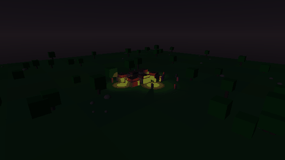
</p>

<table>
  <tr>
    <td align="center">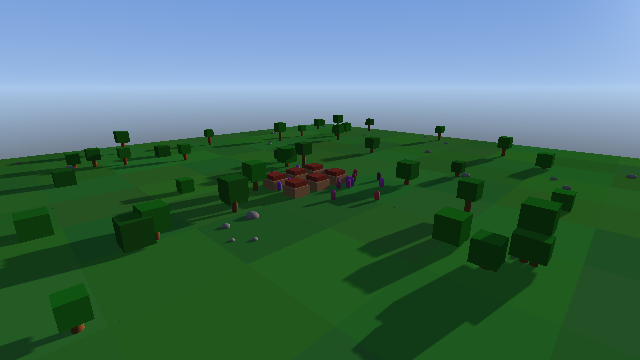<br>morning</td>
    <td align="center">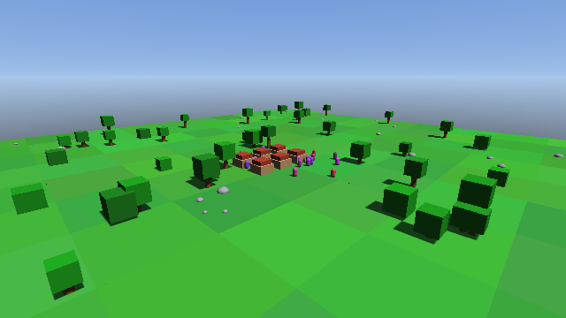<br>noon</td>
    <td align="center">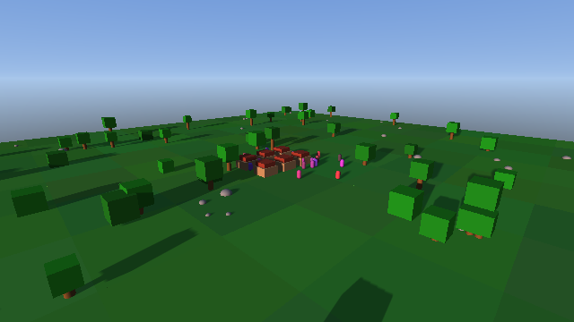<br>dusk</td>
    <td align="center">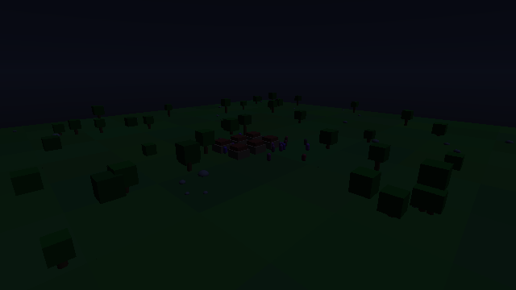<br>night</td>
  </tr>
  <tr>
    <td align="center">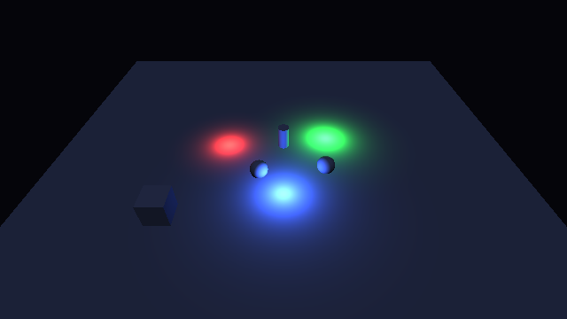<br>point lights (L3)</td>
    <td align="center">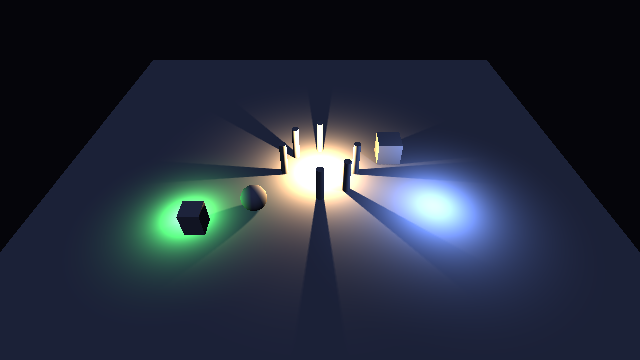<br>point shadows (L4)</td>
    <td align="center">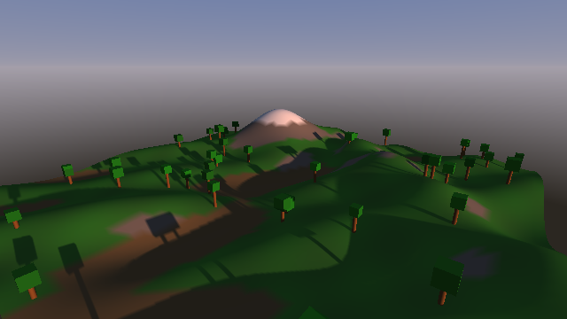<br>terrain (T1)</td>
    <td align="center">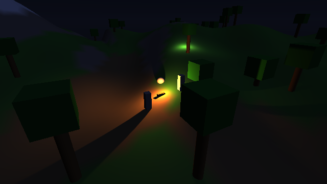<br>terrain at night</td>
  </tr>
  <tr>
    <td align="center">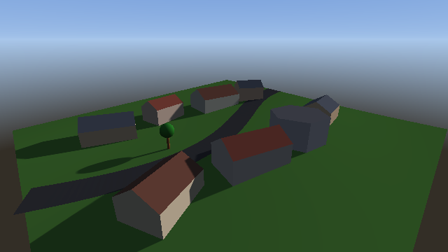<br>static meshes</td>
    <td align="center">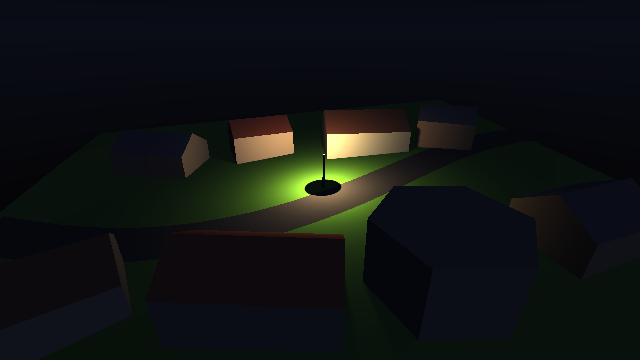<br>meshes at night</td>
    <td align="center">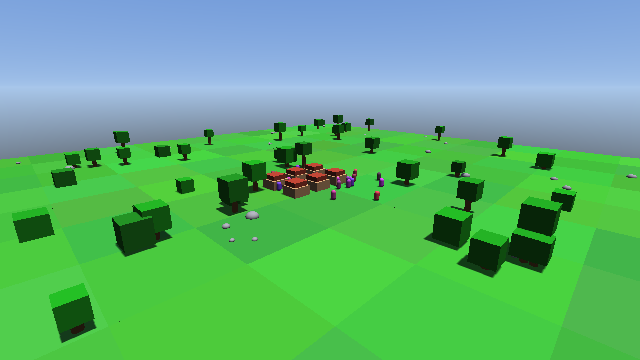<br>June noon, 40° N</td>
    <td align="center">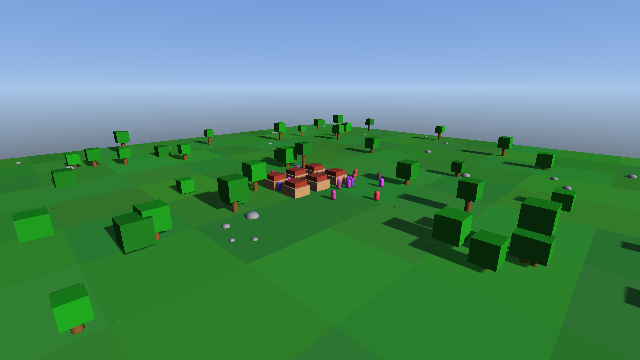<br>December noon, 40° N</td>
  </tr>
  <tr>
    <td align="center">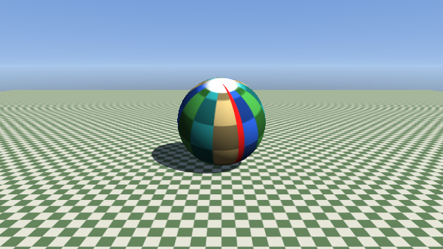<br>textures (ABI 1.7)</td>
    <td align="center">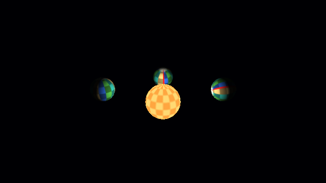<br>tilted, textured planets</td>
  </tr>
</table>

Every image above, apart from the animation, is a golden image that CI
renders on llvmpipe and compares on each pull request. The animation is the L2
village drawn at 39 times of day by `tools/make_readme_media.py`.

Strata is a small C++17 engine for simulation projects. It was built for two
games and is now used by five projects:

- [**Beyond Nations**](https://github.com/Preponderous-Software/beyond-nations),
  whose simulation is C#, reaches Strata through the C ABI.
- [**steading**](https://github.com/Preponderous-Software/steading), a
  USD-native colony sim in C++, uses the renderer and `modules/save`.
- [**orrery**](https://github.com/Preponderous-Software/orrery) draws the solar
  system from JPL data with the overlays and space lighting.
- [**Microbiome**](https://github.com/Preponderous-Software/microbiome) runs its
  micro-environments on `modules/sim`.
- [**Kindling**](https://github.com/Preponderous-Software/kindling), a
  first-person cozy restoration game, uses texture updates, mesh picking and
  relative mouse mode.

It is not a general-purpose engine. There is no editor, and nothing goes in
without a real consumer project that needs it.

The design is Preponderous Software's RFC 0020, *Shared C++ 3D Engine*.

- **Platform:** SDL3 for the window, the GL context and input. A headless EGL
  surface renders with no window and no X server, which is how CI runs.
- **Renderer:** OpenGL 4.5 core with direct state access. It sits behind a thin
  internal device interface (`GpuDevice`) and runs a fixed list of passes. A
  second device, OpenGL ES 3.0, runs the same passes on WebGL 2, so Strata
  also runs in a browser (see [Running in the browser](#running-in-the-browser)).
- **Two front doors:** a C++ API (`include/strata/strata.hpp`) for C++ games,
  and a versioned C ABI (`include/strata/strata.h`) that C# reaches through
  P/Invoke.

## Status

`v0.4.0` adds the browser (a WebGL 2 / GLES 3.0 device built with
Emscripten), a seasonal sun (ABI 1.6), textures and textured meshes (ABI 1.7),
and picking, texture updates and relative mouse mode (ABI 1.8) to `v0.3.0`'s
static meshes (ABI 1.4), unlit overlays and space lighting (**O1**, ABI 1.5)
and `modules/sim`, `v0.2.0`'s point lights (**L3**), point-light shadows
(**L4**) and terrain tile (**T1**), and `v0.1.0`'s skeleton and lighting
**L1–L2**. The C ABI is 1.8: each addition is compatible, and every ABI 1.0
host still works.

| Milestone | What it is | Golden images |
|---|---|---|
| Skeleton | CMake, the C ABI, the GL 4.5 device, SDL3 and EGL surfaces, golden-image harness, Beyond Nations' four primitives drawn from C# | `bn_primitives_legacy` (C++ **and** the C# harness) |
| L1 | A sun driven by time of day, with one shadow map | `l1_sun_single_map` |
| L2 | Four stabilised cascaded shadow maps, a moon at night, hemisphere ambient, fog and an analytic sky | `l2_csm_morning`, `l2_csm_noon`, `l2_csm_dusk`, `l2_csm_night` |
| L3 *(ABI 1.1)* | Up to 32 unshadowed point lights with a range-windowed falloff | `l3_point_lights_night`, `l3_point_lights_falloff` |
| L4 *(ABI 1.2)* | Up to 4 of them cast shadows through cube shadow maps | `l4_point_shadows_pillars`, `l4_point_shadows_night` |
| T1 *(ABI 1.3)* | One static heightmapped terrain tile, lit, casting and receiving sun and point-light shadows | `t1_terrain_noon`, `t1_terrain_morning`, `t1_terrain_night_fire` |
| Static meshes *(ABI 1.4)* | Up to 256 host-built indexed triangle meshes in world space with per-vertex colour, drawn and shadowed like the terrain | `mesh_static_morning`, `mesh_static_night_lamp` |
| O1 *(ABI 1.5)* | Unlit overlays (lines, round points, screen text in a public-domain 8×8 font) and a space lighting mode lit only by point lights | `o1_space_system`, `o1_overlays_sun` |
| Seasonal sun *(ABI 1.6)* | The sun placed from a real date, time, latitude and longitude (NOAA solar position), alongside the time-of-day sun | `sun_june_noon`, `sun_december_noon`, `sun_december_afternoon` |
| Textures *(ABI 1.7)* | RGBA8 textures with mip maps, textured meshes (planet maps on latitude-longitude spheres), unlit emissive meshes, and a model matrix per mesh for spinning about a tilted axis | `tex_globe_sun`, `tex_space_planets` |
| Picking and texture updates *(ABI 1.8)* | Sub-rectangle texture updates (grime cleaned patch by patch), the nearest static-mesh triangle along a ray through each mesh's model matrix, and relative mouse mode for first-person look | `tex_update_grime` (its scene also checks rays) |

Next come streaming and larger terrain (T2–T4), meshes and materials (M1–M4),
and optional OpenUSD modules (`STRATA_WITH_USD`, off by default).

Alongside the renderer, `modules/sim` (`strata::sim`, C++ only, built by
default) holds deterministic simulation building blocks: a seeded RNG, an
entity-component registry with a fixed iteration order, 2D fields with
diffusion and decay, a fixed-step clock and a state fingerprint. See
[modules/sim/README.md](modules/sim/README.md).

## Building

You need CMake 3.24 or newer and a C++17 compiler (GCC 9+, Clang 10+ or MSVC
2022). CMake downloads SDL3 and glm at configure time, and each download is
pinned by SHA-256. On Linux, SDL3 needs the X11 development headers
(`libx11-dev libxext-dev libxrandr-dev libxcursor-dev libxi-dev libxfixes-dev
libxss-dev`, or the matching `-devel` packages).

```sh
cmake -S . -B build -DCMAKE_BUILD_TYPE=Release
cmake --build build -j8
ctest --test-dir build --output-on-failure      # unit tests, no GPU needed
```

The build produces:

- `libstrata.so` (or `strata.dll`). It exports only the C ABI. SDL3 is linked
  in statically, and it does not link `libGL` or `libEGL`: GL entry points are
  loaded through the surface, and `libEGL.so.1` is opened only when a
  headless surface is requested.
- `strata-golden` and `strata-imgcmp`, the golden-image tools (see
  [docs/GOLDEN_IMAGES.md](docs/GOLDEN_IMAGES.md)).
- The `strata::static` CMake target, for C++ games that use the C++ API.

## Running the golden images headless

```sh
export LIBGL_ALWAYS_SOFTWARE=1 GALLIUM_DRIVER=llvmpipe
./build/strata-golden check tests/scenes tests/golden build/golden-out
```

The default surface is EGL surfaceless, so no display is needed. To test the
SDL3 window path instead, start Xvfb **with the llvmpipe variables in its own
environment** and pass `--surface window`:

```sh
LIBGL_ALWAYS_SOFTWARE=1 GALLIUM_DRIVER=llvmpipe Xvfb :99 -screen 0 1024x768x24 &
DISPLAY=:99 ./build/strata-golden check tests/scenes tests/golden build/golden-out --surface window
```

## Running in the browser

<p align="center">
  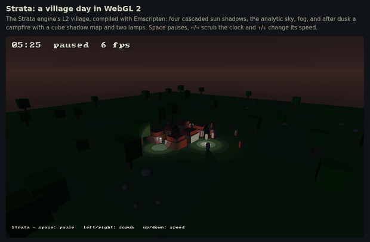
</p>

Strata builds with Emscripten and draws through WebGL 2, with the same C ABI.
Every render path works there: cascaded sun shadows, point lights and their
cube shadow maps, terrain, static and textured meshes, overlays and the sky.
The animation above is the browser demo, `examples/village-day`, captured in
headless Chromium. Chromium was drawing with SwiftShader, its software WebGL on
the CPU, so the frame counter says nothing about speed on a GPU.

```sh
source /path/to/emsdk/emsdk_env.sh               # emsdk 6.0.11 in CI
emcmake cmake -S . -B build-web -DCMAKE_BUILD_TYPE=Release
cmake --build build-web -j8
cd build-web && python3 -m http.server 8000      # open /strata-village-day.html
```

The build makes `libstrata.a` (the engine and SDL3 in one archive) to link into
your own page, the demo, and a web page of the golden-image checker. CI draws
every golden scene in headless Chromium and compares the result with both a
browser golden set and the desktop goldens. Desktop builds keep OpenGL 4.5 as
the default. [docs/WEB.md](docs/WEB.md) covers linking, surfaces, the frame
loop, what WebGL 2 emulates and how, and notes for .NET `browser-wasm` hosts.

## Using it from C#

`bindings/csharp/Strata.Interop` declares the C ABI for P/Invoke.
`tests/csharp/Strata.PrimitivesHarness` shows the whole path:

1. A struct laid out like Beyond Nations' `RenderItem` is checked against
   `strata_struct_size` and `strata_struct_field_offset`.
2. The camera is built with `System.Numerics`.
3. The managed array is passed to `strata_submit_primitives` as a pointer,
   with no copy or conversion.

```sh
dotnet run --project tests/csharp/Strata.PrimitivesHarness -c Release -- \
  tests/scenes/bn_primitives_legacy.scene out.png --native-dir build
./build/strata-imgcmp tests/golden/bn_primitives_legacy/linux-llvmpipe.png out.png
```

A host that already owns a window and a GL context, as Beyond Nations' Silk.NET
host does today, creates Strata with `STRATA_SURFACE_HOST_CONTEXT` and a
`get_proc_address` callback. Strata then draws into that context and puts back
the GL state it touched.

## Documentation

- [ARCHITECTURE.md](ARCHITECTURE.md): layers, the C ABI rules, the pass list and
  the lighting model.
- [CONTRIBUTING.md](CONTRIBUTING.md): building, testing, golden-image policy and
  PR conventions.
- [docs/GOLDEN_IMAGES.md](docs/GOLDEN_IMAGES.md): how images are compared, and
  the tolerances.
- [docs/WEB.md](docs/WEB.md): building for the browser (Emscripten, WebGL 2),
  linking `libstrata.a`, and what differs from the desktop.
- [THIRD_PARTY_NOTICES.md](THIRD_PARTY_NOTICES.md): dependency licences.

## Licence

MIT. See [LICENSE](LICENSE).
