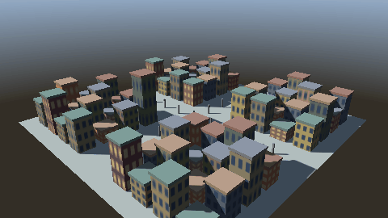
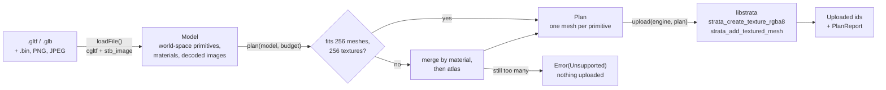
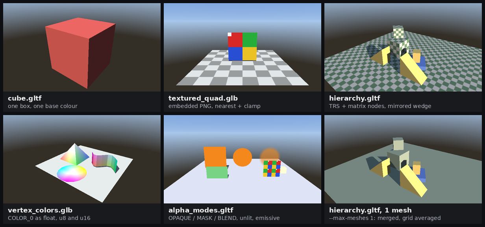
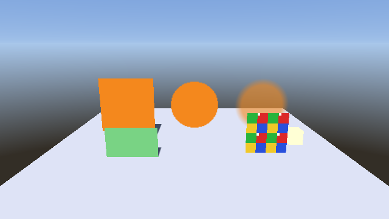

# glTF 2.0 loading

`modules/gltf` loads `.gltf` and `.glb` files onto a Strata engine. It is a
host-side library: it reads the file, fits the scene into Strata's limits and
then creates textures and meshes through the public C ABI
(`strata_create_texture_rgba8`, `strata_add_textured_mesh`). libstrata itself
is unchanged, and any libstrata of ABI 1.15 or later will do (1.15 added
per-vertex RGBA colours).

<p align="center">
  
  <br><em>A synthetic block town: 145 meshes and 24 textures in one <code>.glb</code>, drawn through the C ABI.</em>
</p>



*Load reads the file into plain data, `plan()` fits it to the engine's
budget, and `upload()` sends it through the public C ABI. Each step is
usable alone; `strata_gltf_load` runs all three.*

## What it looks like



*The synthetic test assets (`modules/gltf/tests/make_fixtures.py`) as
`strata-gltf-view` draws them for the goldens. The last cell is the same
hierarchy with `--max-meshes 1`: one merged mesh, with the repeating grid
texture replaced by its average colour.*



*`alpha_modes.gltf` close up: `OPAQUE` ignores alpha, `MASK` is cut out,
`BLEND` is see-through, and the lamp cube is emissive (drawn unlit).*

The module is built when `STRATA_WITH_GLTF` is on, which is the default on
desktop and off in an Emscripten build. It fetches nothing: the parser is
[cgltf](https://github.com/jkuhlmann/cgltf) 1.15 (MIT), vendored in
`third_party/cgltf`, and images are decoded with the vendored `stb_image`
(PNG and JPEG).

| Target | What it is |
|---|---|
| `strata_gltf` (`strata::gltf`) | The C++ library: `model.hpp` (load), `plan.hpp` (fit), `upload.hpp` (send) |
| `strata_gltf_shared` | `libstrata_gltf.so` / `strata_gltf.dll`: the C API in `strata/gltf/strata_gltf.h`, for bindings. It sits beside libstrata and finds it there |
| `strata-gltf-view` | A command-line tool that renders a file headless to a PNG |

## What is read

| glTF | How Strata draws it |
|---|---|
| Scenes and nodes | The default scene (else scene 0, else every root node). Node transforms, whether TRS or a matrix, are applied, so every vertex is in world space. A node with a negative determinant (a mirror) has its triangle winding flipped back to counter-clockwise |
| Meshes and primitives | Every triangle primitive: lists, strips and fans; indexed by uint8, uint16 or uint32, or not indexed. Points and lines are skipped and reported |
| `POSITION`, `NORMAL` | Float or quantized (`KHR_mesh_quantization`) data. Without `NORMAL`, flat normals are made, as the glTF spec asks: every triangle gets three vertices of its own |
| `COLOR_0` | RGB or RGBA, float or normalized uint8/uint16. It multiplies the base colour factor and the texture |
| `TEXCOORD_n` | The set the base colour texture names, with `KHR_texture_transform` applied |
| `baseColorFactor`, `baseColorTexture` | Factor x `COLOR_0` becomes the vertex colour; the texture multiplies it. `KHR_materials_pbrSpecularGlossiness` diffuse is used the same way |
| Samplers | `CLAMP_TO_EDGE` becomes `STRATA_TEXTURE_CLAMP_U/V`, `REPEAT` and `MIRRORED_REPEAT` both repeat, a `NEAREST` mag filter becomes `STRATA_TEXTURE_NEAREST`, and a mipmapping (or unset) min filter becomes `STRATA_TEXTURE_MIPMAPS` |
| `alphaMode` `OPAQUE` | An opaque mesh; texel alpha is ignored |
| `alphaMode` `BLEND` | `STRATA_MESH_TRANSLUCENT`, mesh alpha = the factor's alpha, times texel alpha |
| `alphaMode` `MASK` | By default a translucent mesh whose texture has the cutoff baked into its alpha (each texel either 0 or 255), so cut-out leaves and fences look cut out. Strata has no alpha test, so such a mesh writes no depth and casts no shadow. `MaskPolicy::Opaque` draws it opaque instead. The cutoff is kept on the mesh's record either way |
| `doubleSided` | Opaque meshes get a reversed copy of each triangle, since Strata culls back faces (translucent meshes already draw both) |
| `emissiveFactor` (x `KHR_materials_emissive_strength`) | By default `STRATA_MESH_UNLIT`, coloured base colour + emissive, so lamps and signs glow. `EmissivePolicy::Ignore` draws them lit. The emissive colour is kept on the mesh's record either way; an `emissiveTexture` is noted but not sampled |
| `KHR_materials_unlit` | `STRATA_MESH_UNLIT` |
| Skins, morph targets, animations | Ignored: the rest pose is drawn, with a note |
| `KHR_draco_mesh_compression`, `EXT_meshopt_compression`, `KHR_texture_basisu`, `EXT_texture_webp` | Not decoded: the primitive or texture is skipped with a note |
| Cameras, lights | Not read |

### Colour

Strata draws every colour and texel as given, with no sRGB decode and no
output encode (see [ARCHITECTURE.md](../ARCHITECTURE.md#colour-space)). glTF
defines base colour textures as sRGB and factors and vertex colours as
linear. The colour policy chooses how they meet:

| `ColorPolicy` | Texels | Factors, `COLOR_0`, emissive |
|---|---|---|
| `Display` (default) | as stored (sRGB) | sRGB-encoded first, so an unlit surface shows what a glTF viewer shows |
| `Linear` | sRGB-decoded to linear | as given: for a host that encodes the output itself |
| `AsStored` | as stored | as stored: no conversion at all |

## Fitting into Strata's limits

A scene holds at most 256 meshes (`STRATA_MAX_MESHES`) and 256 textures
(`STRATA_MAX_TEXTURES`) of at most 8192 texels a side, and a mesh at most
2^24 vertices. `plan()` takes three steps, each only when the one before is
not enough, and records every step in its report:

1. **One mesh per primitive**, one texture per glTF texture used (a `MASK`
   material's cutoff makes its own copy of a texture). Images larger than
   `maxTextureSize` are scaled down.
2. **Merge by material**: primitives that draw the same way (the same
   texture, the same opaque, translucent or unlit flags and the same mesh
   alpha) are joined into one mesh. Base colour factors are already in the
   vertex colours, so different materials can share a mesh. A mesh past the
   vertex limit is split.
3. **Atlas**: textures whose uvs stay inside 0..1 are packed onto atlas pages
   of `atlasSize` texels (4096 by default) with a 4-texel edge-extended
   gutter, scaled down together until they fit the pages left, and their
   uvs remapped. Textures that repeat (uvs outside 0..1) keep a texture each
   while the budget lasts, the most used first; past it, their primitives
   take the texture's average colour instead. If that is still too many
   meshes, a white texel is added to the atlas so that untextured primitives
   can share a mesh with textured ones.


*Before and after the budget steps, on a synthetic block town of 145
primitives and 24 window textures. Squeezed to `--max-meshes 4
--max-textures 1`, the textures are packed onto one atlas page and the
primitives merged into two meshes (the atlased facades, and the untextured
roofs, posts and ground), and the picture is the same. Made by
`tools/make_gltf_media.py`.*

When even that cannot meet the budget (for example one mesh for a scene with
both opaque and translucent materials), `plan()` throws
`Error(Unsupported)` and the C API returns `STRATA_ERROR_UNSUPPORTED`;
nothing is left on the engine.

The report, as `strata-gltf-view` prints it for the `alpha_modes.gltf` test
asset squeezed into four meshes and two textures (`--max-meshes 4
--max-textures 2`):

```text
primitives in:        7
textures in:          2
meshes out:           4 (merged by material)
textures out:         1 (1 atlas page(s), scale 1)
vertices / triangles: 54 / 26
repeating dropped:    1 (1 primitives)
MASK as blend/opaque: 1 / 0
emissive as unlit:    1
back faces added:     2
note: untextured primitives sample a white texel in the atlas so they can share meshes
note: 1 MASK primitive(s) drawn translucent with the cutoff baked into texel alpha (no depth writes or shadows; Strata has no alpha test)
note: 1 repeating texture(s) over budget replaced by their average colour on 1 primitive(s)
```

`PlanReport::json()` (and `strata_gltf_report_json`) gives the same as one
JSON object.

Atlas pages are mipmapped when any image on them was; at the smallest mip
levels neighbouring images bleed into each other past the gutter. Repeating
textures are never atlased, because an atlas cannot repeat one image.

## C++

```cpp
#include "strata/gltf/model.hpp"
#include "strata/gltf/plan.hpp"
#include "strata/gltf/upload.hpp"

strata::gltf::Model model = strata::gltf::loadFile("town.glb");  // throws strata::gltf::Error
strata::gltf::BudgetOptions budget;
budget.maxMeshes = 200;  // leave 56 for the host's own
strata::gltf::Plan plan = strata::gltf::plan(model, budget);
strata::gltf::Uploaded ids;
StrataStatus status;
std::string error;
if (!strata::gltf::upload(engine, plan, ids, &status, &error)) { /* nothing was left behind */ }
// plan.meshes[i] describes ids.meshIds[i]: label, source material(s), alphaMode,
// alphaCutoff, doubleSided, emissive.
strata::gltf::remove(engine, ids);
```

`Model` is plain data (world-space primitives, materials, textures and
decoded images) and needs no engine, so a host can inspect or edit it before
planning. Link `strata::gltf`.

## C, Python and C#

```c
#include "strata/gltf/strata_gltf.h"

StrataGltfOptions options = {sizeof options};
options.scene = -1;
options.max_meshes = 200;
StrataGltfScene* scene = NULL;
if (strata_gltf_load(engine, "town.glb", &options, &scene) != STRATA_OK) {
    fprintf(stderr, "%s\n", strata_gltf_last_error());
}
StrataGltfInfo info;
strata_gltf_get_info(scene, &info);          /* counts, bounds, merged/atlased */
StrataGltfMeshInfo mesh;
strata_gltf_get_mesh(scene, 0, &mesh);       /* engine ids, flags, alpha mode, cutoff, emissive */
puts(strata_gltf_report(scene));
strata_gltf_unload(engine, scene);           /* removes the meshes and textures */
```

Zero option fields take the defaults; a NULL `options` takes them all (and
scene -1).

Python (`bindings/python/strata/gltf.py`) loads `libstrata_gltf` from beside
the libstrata it was given:

```python
import strata
from strata import gltf

lib = strata.load()
loader = gltf.load_library(beside=lib)
with strata.Engine(lib, 1280, 720) as engine:
    with loader.load(engine, "town.glb", max_meshes=200) as scene:
        print(scene.info.mesh_count, scene.report)
        ...
```

C#: `StrataGltfNative` in `bindings/csharp/Strata.Interop`;
`StrataNative.UseLibraryDirectory(dir)` resolves both libraries from `dir`.

## strata-gltf-view

```sh
strata-gltf-view <in.gltf|in.glb> <out.png> [options]
```

| Option | Default | |
|---|---|---|
| `--size WxH` | 640x360 | |
| `--camera iso\|front\|back\|left\|right\|top` | iso | A direction; the camera is placed to frame the fit box |
| `--fit PERCENT\|bounds` | 95 | The fit box holds the central PERCENT of vertices on each axis, plus a 5 % margin, so a huge water or ground plane, or one stray far object, does not shrink the scene. `bounds` frames everything |
| `--zoom F` | 1 | Distance multiplier on the framed camera |
| `--eye X,Y,Z`, `--target X,Y,Z` | | A placed camera instead of a preset |
| `--cameras FILE`, `--view NAME` | | A placed camera from a JSON file (below) |
| `--fov DEGREES` | 45 | Vertical field of view |
| `--sun morning\|noon\|afternoon\|evening\|legacy\|0..1` | afternoon | Time of day for `STRATA_LIGHTING_SUN`; `legacy` uses `STRATA_LIGHTING_LEGACY` |
| `--latitude DEGREES` | 40 | |
| `--no-shadows`, `--fog`, `--shadow-distance M` | | |
| `--scene N`, `--max-meshes N`, `--max-textures N`, `--max-texture-size N`, `--atlas-size N`, `--merge`, `--no-back-faces` | | The load options above |
| `--colors display\|linear\|stored`, `--mask blend\|opaque`, `--emissive unlit\|ignore` | display, blend, unlit | |
| `--json FILE` | | Writes the report as JSON |
| `--quiet` | | No report on stdout |

Far reaches the furthest point of the whole scene, not only the fit box, so
nothing is clipped away.

A cameras file is any JSON object with a `cameras` object of named cameras,
in the glTF file's coordinates; other keys are ignored. An optional `sun`
object names times of day for `--sun` and gives the latitude:

```json
{
  "cameras": {
    "doorway": {"eye": [4, 1.7, 12], "target": [0, 1.2, 0], "fov_y_deg": 60},
    "aerial": {"eye": [0, 120, 90], "target": [0, 0, 0], "fov_y_deg": 50}
  },
  "sun": {"times": {"dawn": 0.27, "dusk": 0.73}, "latitude_deg": 52}
}
```

Without `--view` the first camera by name is used.

## Tests

- `strata-gltf-tests` (CPU only): loading each synthetic asset, transforms
  and winding, colour encodings, alpha modes, emissive, every planning step
  and the atlas packer.
- `strata-gltf-e2e` (headless GL; skipped without it): the C API loads,
  draws and unloads each asset, failures leave nothing behind.
- `strata-gltf-goldens`: `modules/gltf/tests/check_goldens.py` renders seven
  cases with `strata-gltf-view` and compares them with
  `modules/gltf/tests/golden/<name>/linux-llvmpipe.png` by
  [GOLDEN_IMAGES.md](GOLDEN_IMAGES.md)'s rules (the same `strata-imgcmp`
  tolerance). To bless after an intended change:

  ```sh
  export LIBGL_ALWAYS_SOFTWARE=1 GALLIUM_DRIVER=llvmpipe
  python3 modules/gltf/tests/check_goldens.py --view build/strata-gltf-view \
      --imgcmp build/strata-imgcmp --out build/gltf-golden-out --bless [--only NAME]
  ```

  As with the scene goldens, bless from CI's Mesa: CI's golden job uploads
  `golden-out/gltf/<name>.actual.png`.
- `strata-gltf-fixtures`: the assets in `modules/gltf/tests/assets` are
  exactly what `make_fixtures.py` writes (standard library only; PNGs use
  stored deflate blocks so every zlib gives the same bytes).
- `tests/python/test_gltf.py` and `tests/csharp/.../GltfTests.cs`: the
  bindings' struct layouts, and loading and drawing through them.

## What the engine could add

The loader works within ABI 1.19. These additions would let it draw glTF
more faithfully:

- **Alpha test**: a mesh flag plus a cutoff, so `MASK` draws opaque with
  depth writes and shadows instead of translucent.
- **Emissive**: an emissive colour (and texture) per mesh added after
  lighting, instead of drawing emissive meshes unlit.
- **Back-face culling off** per mesh, instead of duplicating the triangles
  of `doubleSided` materials.
- **sRGB textures**: a texture flag that decodes sRGB on sampling, for the
  `Linear` policy without 8-bit banding.
- **Per-vertex alpha** on translucent meshes (`COLOR_0` alpha is ignored
  today).
- **More meshes or instancing**, so large scenes need not be merged.
