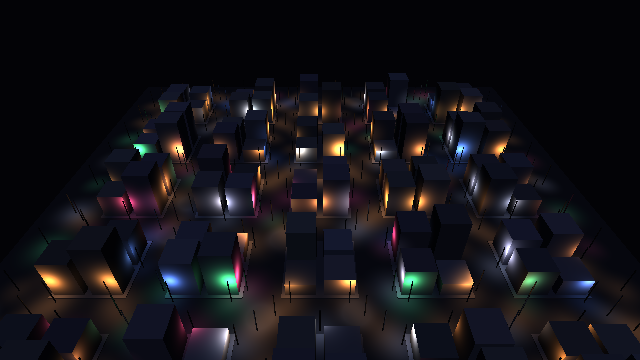

# Lighting with many lights

Strata lights a scene with a key light (the sun or moon), ambient terms and
lists of point and spot lights (see ARCHITECTURE.md, "Lighting"). Without help,
every lit fragment evaluates every light in both lists, so the lists are
capped at `STRATA_MAX_POINT_LIGHTS` and `STRATA_MAX_SPOT_LIGHTS` (32 each) and
the cost of a frame grows with the number of lights set, whether they are near
a pixel or across the map. A town at night has more lamps than that: every
street lamp, porch light, window and sign wants a pool of light of its own.

**Clustered light culling** (ABI 1.21) lifts the caps to
`STRATA_MAX_CLUSTERED_LIGHTS` (4096 point and 4096 spot lights) and makes a
fragment pay only for the lights that can reach it. It is opt in:

```c
strata_set_light_culling(engine, STRATA_LIGHT_CULLING_CLUSTERED);
strata_set_point_lights(engine, lamps, 900);    /* up to 4096 */
strata_set_spot_lights(engine, spots, 120);     /* up to 4096 */
...
StrataLightStats stats;
strata_get_light_stats(engine, &stats);          /* what the last frame culled */
```

Python: `engine.set_light_culling(strata.LIGHT_CULLING_CLUSTERED)` and
`engine.light_stats()`. C#: `StrataNative.strata_set_light_culling` and
`strata_get_light_stats`. Scene files: `light_culling clustered`.



*The `light_clustered_street_night` golden: 240 point lights and 16 spot
lights (one shadowed), written by `tools/gen_street_lights_scene.py`.*

## Compatibility

- `STRATA_LIGHT_CULLING_NONE` stays the default. Under it nothing changes:
  the same caps, the same uniform block, the same loops in the shader, and
  every earlier golden drawn bit for bit. A host built against 1.20 or older
  never sees the new path.
- The same lights draw the same picture either way. Light lists keep the
  order the lights were set in, and a light that is not listed in a cluster
  adds exactly zero there without culling too (its range window is zero).
  Point lights go through the same arithmetic; a spot light's cone factor is
  computed in an equivalent but rearranged form (see below), which can round
  differently. Measured: a 32 point + 16 spot light street scene (shadowed
  lights included) differed in one byte of one pixel, by one step, on the
  GL 4.5 and GLES 3 devices; the Python test allows one step per channel, in
  perspective and orthographically.
- Switching back to `STRATA_LIGHT_CULLING_NONE` while a list holds more
  lights than the default allows is `STRATA_ERROR_INVALID_STATE`, and nothing
  changes: set fewer lights first. Setting more than 32 lights without
  culling is `STRATA_ERROR_INVALID_ARGUMENT`, as before, and the message now
  names clustered culling.
- Shadows are unchanged: at most `STRATA_MAX_SHADOWED_POINT_LIGHTS` (4) point
  and spot lights in all cast cube-map shadows, whichever mode is on.
- `StrataLightStats` and `strata_get_light_stats` are new (struct id 20). The
  existing `StrataFrameStats` does not change.

## Design

Two common ways to light a scene with many lights in forward shading are a
short list of the nearest lights per draw, and clustered (or tiled) forward
shading. Strata draws its primitives instanced, a whole kind of primitive in
one draw that can span the map, so a per-draw (per-mesh) list of the nearest
N lights would light most of a street of instanced lamp posts with the wrong
lamps. Clustered shading picks lights per pixel, so it fits every pass the lit
shader serves: instanced primitives, the terrain, static meshes and
translucent meshes. Deferred shading would mean a G-buffer, which the
renderer does not have and which would not serve translucent meshes.

### The grid

The view frustum is cut into **16 × 9 screen tiles × 24 depth slices** (3456
clusters) whatever the drawable's size. Tiles split the viewport evenly.
Slices split view depth (the distance in front of the eye) from the near plane
to the far plane: exponentially for a perspective camera (each slice the same
ratio deeper than the last, so near slices are thin and far ones deep, as
perspective makes them on screen), evenly for an orthographic one
(`strata_camera_ortho`, or any projection with an orthographic last row).

### Assigning lights (CPU, every lit frame)

`src/render/clusters.cpp`, pure maths with unit tests:

1. Each light becomes a sphere of its range (a spot light too: its cone lies
   inside it). The sphere's depth range is clipped to the near and far
   planes; a light wholly behind the eye or beyond the far plane is skipped.
2. The view-space box around the sphere, cut to that depth range, is
   projected: its eight corners' extremes bound it on screen exactly, since
   the box lies in front of the eye. That gives a range of tiles, and the
   depth range a range of slices, each widened a hair so the CPU's and the
   GPU's rounding cannot disagree.
3. Within that block, each cluster's view-space bounding box (from the eight
   corners of its tile at its two slice depths) is tested against the sphere,
   which drops the corners of the block that a round light does not reach.
4. A counting sort by cluster turns the (cluster, light) pairs into one list
   per cluster, each in ascending light order (points first, then spots), so
   the shader sums lights in the order the host set them.
5. A cluster that more than `STRATA_MAX_LIGHTS_PER_CLUSTER` (256) lights reach
   keeps the 256 that light its centre most (falloff from the nearest point of
   a sphere around the cluster, times intensity × brightest colour channel)
   and counts in `clusters_overflowed`. A scene that overflows is asking for
   more than 256 lights on one pixel; dim or merge lights first.

The unit tests (`tests/unit/test_clusters.cpp`) scatter 400 lights over a
street-sized area and check 20,000 points in perspective and orthographic
views: every light that reaches a point is in that point's cluster. They also
check culling out of view, sorted lists and the overflow cut.

### Getting the lists to the GPU

GLES 3.0 and WebGL 2 have no storage buffers, and a uniform block may be as
small as 16 KB, so the lists travel in **one RGBA32F texture**, 1024 texels a
row, read with `texelFetch` (no filtering, so no float-filtering extension):

| Texels | Holds |
|---|---|
| 3 per light, from 0 | position and range; colour × intensity and shadow slot; direction × s and an offset (the cone factor is `clamp(dot(-l, xyz) + w)`, with s = 1 / (cos inner − cos outer) and w = −cos outer × s; a point light is 0, 0, 0, 1, a factor of 1 everywhere) |
| 1 per cluster | first list texel, light count |
| the lists | four light indices a texel, each list starting on a texel of its own |

All indices and offsets are integers stored as floats, exact below 2²⁴. The
texture grows by powers of two in height and is never smaller than a frame
needs. It is a **ring of three** textures: each frame writes the next one, so
the upload never has to wait for a frame the GPU may still be drawing with
the previous one (llvmpipe waits otherwise, which cost about 300 ms a frame
under load before the ring). The data is bound to **texture unit 10** in
every lit pass, under both modes, so the GLES device saves and restores one
more unit for a host context and needs 12 fragment units (WebGL 2 promises
16).

The `PointLights` uniform block (binding 2) gains four vectors after the 1.20
arrays: the grid size and an on flag, where the headers and the lists start,
the near plane and slice scale (and whether the camera is orthographic), and
one over the viewport size. Under culling the arrays stay empty.

### The shader

`pointLights()` in the lit fragment shader (shared by primitives, terrain,
meshes and translucent meshes) starts with
`if (uClusterGrid.w != 0) return clusterLights(world, normal);`, a branch on a
uniform that every fragment takes the same way, and is otherwise untouched.
`clusterLights` finds its tile from `gl_FragCoord`, its slice from the view
depth the vertex shader already passes (`vViewDepth`) with the CPU's formula,
reads its cluster's header and loops over the list four lights per index
texel: three texel reads per light, then the same falloff, cone, Lambert term
and cube-shadow lookup as the 1.20 loops.

## Cost

Frame times on **llvmpipe** (Mesa 21.2.6, LLVM 12, `LP_NUM_THREADS=4`,
640 × 360 headless, GL 4.5 device), each the median of 15 timed frames after
4 warm-up frames, timing `begin_frame` + submit + `end_frame` +
`read_pixels` (the readback waits for the GPU, so each sample is a whole
frame). The scene is `tools/gen_street_lights_scene.py --spots 0
--no-shadow --lamps N`: the 640 × 360 view of the golden, with N lamps (up to
about 250 along the streets, the rest scattered over the blocks), no spot
lights and no shadows, so the lights are the only thing that changes.

| Lights | Culling | Frame (median ms) | Lights in view | List entries | Longest list |
|---:|---|---:|---:|---:|---:|
| 0 (32 posts) | none | 43 | | | |
| 0 (1024 posts) | none | 64 | | | |
| **32** | **none (the 1.20 path)** | **250** | 32 (all, every fragment) | | |
| 32 | clustered | 60 | 30 | 348 | 5 |
| 64 | clustered | 84 | 61 | 757 | 10 |
| 256 | clustered | 192 | 243 | 2704 | 27 |
| 1024 | clustered | 791 | 1008 | 11823 | 99 |

Each row is the median of three runs' medians; runs of one configuration
spread by up to about 20 %. The first two rows are the same towns with no
lights at all, the cost of the geometry alone. Under culling, 256 lamps cost
less than 32 lamps without it, and 32 lamps cost a quarter. At 1024 the town
is crowded (lamps scattered over the blocks as well as the streets, about 30
listed per lit cluster on average and 99 at most), and the frame is
dominated by lights that do reach each pixel.

Read the numbers as ratios: llvmpipe shades on the CPU, and the machine was
shared and busy during the runs (load average between 20 and 60 on 20
threads), so absolute times are inflated and noisy, but each configuration
was run in turn, three times over. A GPU spends far less per light, and the gap between
the two paths narrows or widens with how texel fetches compare with uniform
reads on it; the shape is the same: without culling, cost grows with every
light in the scene, with culling, with the lights that reach each pixel.

The CPU side (`cpu_ms_culling` in `StrataLightStats`: listing, packing and
starting the upload) stayed under a millisecond even at 1024 lights.

## Limits and next steps

- **Lights per pixel still cost.** Culling removes lights that cannot reach a
  pixel; it does nothing for a pixel that 100 lights do reach. Keep ranges as
  short as the look allows: a lamp's pool rarely needs more than a few metres.
- **The grid is fixed** (16 × 9 × 24). Wide-screen or very tall drawables get
  wider or taller tiles. Very large far planes make each slice deeper; a near
  plane that is too small for the scene wastes slices close to the eye (the
  advice in [LARGE_SCENES.md](LARGE_SCENES.md) applies twice over).
- **Spot lights are culled by their sphere**, not their cone, so a narrow
  spot light is listed in clusters it cannot light. A cone test is a possible
  refinement.
- **Shadows**: still four shadowed lights in all, each six cube faces a frame.
- **Web kit**: the kit's quality tiers still cut lights to
  `STRATA_MAX_POINT_LIGHTS` (kit 1.2); a kit that turns clustered culling on
  for a tier is a follow-up.
- **Not done here**: building the lists on the GPU (compute shaders are not
  in WebGL 2), light lists per mesh for meshes that do not move, and
  clustered culling for anything beyond point and spot lights.
