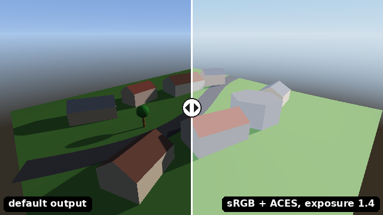
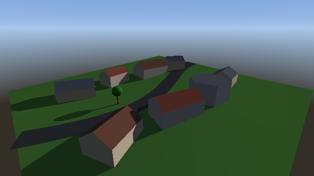
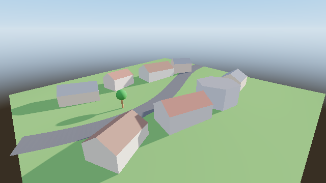

# Materials, spot lights, orthographic camera and colour output (ABI 1.20)

ABI 1.20 adds mesh materials (alpha cutout, emission, normal maps,
two-sided faces), sRGB textures, spot lights, an orthographic camera and an
opt-in tonemapped sRGB output. Every addition is off by default, so the
defaults draw the same pixels as 1.19. The API is in
[`include/strata/strata.h`](../include/strata/strata.h); how each one works
inside the renderer is in [ARCHITECTURE.md](../ARCHITECTURE.md) (colour
space, spot lights, orthographic cameras, materials).

## What it looks like


*The six new goldens, each a synthetic scene in `tests/scenes/` (the
comments at the top of each `.scene` file say what to look for). Built from
`tests/golden/<name>/linux-llvmpipe.png` by `tools/make_materials_media.py`.*

| Golden | What it shows | API |
|---|---|---|
| `mat_cutout_shadows` | Left, a two-sided cutout card seen from behind; middle, two crossed cutout cards (a foliage billboard); right, the same texture with no cutoff: a solid card and a solid shadow. The cutout cards' shadows have the same holes as the cards | `StrataMaterial.alpha_cutoff`, `STRATA_MATERIAL_DOUBLE_SIDED` |
| `mat_emissive_night` | Window blocks glowing at night from an emissive checker (the right one decoded from sRGB, so deeper and darker), a cyan sign and a red unlit cap. Emission lights nothing around it: only the warm lamp lights the street | `emissive`, `emissive_strength`, `emissive_texture`, `STRATA_TEXTURE_SRGB` |
| `mat_normal_map` | The same dome normal map on three panels: as usual, with mirrored uvs (still lit from the sun side, since the tangent frame comes from screen-space derivatives) and with scale 0 (flat); and on each side of a box | `normal_texture`, `normal_scale` |
| `light_spot_cones` | Three downward spots with a hard, a soft and a narrow edge, and a shadowed blue spot shining through a cutout card so only the blobs cast shadows | `StrataSpotLight`, `strata_set_spot_lights`, `STRATA_SPOT_LIGHT_CAST_SHADOWS` |
| `cam_ortho_shadows` | A 7 x 7 grid of pillars from an isometric-style orthographic camera; every pillar, near or far, casts a crisp shadow because the cascades are fitted to the orthographic box | `strata_camera_ortho` |
| `output_srgb_aces` | The `mesh_static_morning` town with an sRGB encode and the ACES tonemap at exposure 1.4 | `strata_set_color_output` |

## Tonemapping, before and after



*Drag-slider style: the left half is `mesh_static_morning` (default output,
no encode), the right half `output_srgb_aces`, the same scene with
`strata_set_color_output(engine, STRATA_OUTPUT_SRGB |
STRATA_OUTPUT_TONEMAP_ACES, 1.4f)`. The mid-tones lift and the brightest
surfaces roll off instead of clipping; the sky and fog colours are decoded
first, so the sky keeps its look apart from the tonemap.*

The two full frames:

<table>
  <tr>
    <td align="center"><br><em>default output (<code>mesh_static_morning</code>)</em></td>
    <td align="center"><br><em>sRGB + ACES, exposure 1.4 (<code>output_srgb_aces</code>)</em></td>
  </tr>
</table>

## In scene files

`strata-golden` scene files reach all of it (see
[GOLDEN_IMAGES.md](GOLDEN_IMAGES.md)):

| Directive | What it sets |
|---|---|
| `camera_ortho eye target half_height near far` | `strata_camera_ortho` |
| `light spot x y z range dx dy dz r g b intensity inner outer [shadow]` | One `StrataSpotLight` (angles in degrees) |
| `output [srgb] [reinhard\|aces] [exposure E]` | `strata_set_color_output` |
| `mesh_cutoff C`, `mesh_double_sided` | Alpha cutout and two-sided faces on the last mesh |
| `mesh_emissive r g b strength [texture]` | Emission on the last mesh |
| `mesh_normal_map texture scale` | A normal map on the last mesh |
| `texture ... srgb` | `STRATA_TEXTURE_SRGB` |
| `texture NAME discs ...`, `texture NAME bumps ...` | Two synthetic test textures: round blobs on transparent texels, and a tangent-space dome normal map |

## Regenerating the pictures

The pictures are the goldens, so bless first if a scene changed, then:

```sh
python3 tools/make_materials_media.py
```
