# Made with Strata

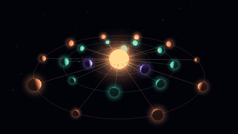

The family, drawn by Strata v0.7.0 itself through the Python binding
(`tools/make_family_media.py`). Inner ring, violet: renders and previews.
Middle ring, teal: simulations and views. Outer ring, orange: games. Each
sphere's size is its GitHub repository size on a log scale (read on
2026-10-29; Ophidian, Tic Tak Toe, Apex and graphik on 2026-11-20), from
Familiar at 125 KB to Beyond Nations at about 74 MB. The core's
point light gives each one its lit side. A still is in
[`media/showcase/family.jpg`](media/showcase/family.jpg).

Every public project that draws with Strata, with a picture from the project
itself. Each image is copied from that project's own README or docs at the
commit named under it and downscaled to fit here (a still frame where the
original is an animation; follow the link to see it move), or, where a project has no
pictures yet, taken from its live page. None is a mock-up.

Projects that run in a browser are also in the arcade at
<https://danielstephenson.dev/play>.

- [Games](#games)
- [Simulations and views](#simulations-and-views)
- [Renders and previews](#renders-and-previews)
- [Adding a project](#adding-a-project)

## Games

### Beyond Nations

A sandbox nation-simulation RPG: settlements, resources and rival nations grow
around you. The simulation is C# and reaches Strata through the C ABI.
[Repository](https://github.com/Preponderous-Software/beyond-nations) ·
[play in the browser](https://beyond-nations.play.danielstephenson.dev)

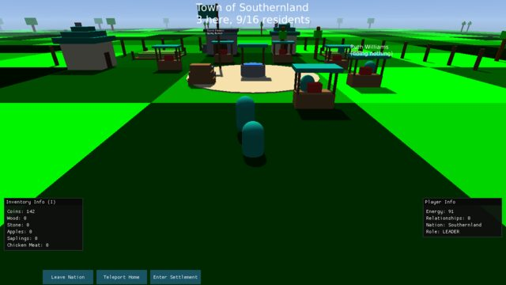

`.github/media/settlement-town.png` at `Preponderous-Software/beyond-nations@e012fb0`

### steading

A USD-native colony sim in C++: OpenUSD is the world, save and mod format over
a flat ECS runtime. It uses the renderer and `modules/save`.
[Repository](https://github.com/Preponderous-Software/steading) ·
[play in the browser](https://steading.play.danielstephenson.dev)

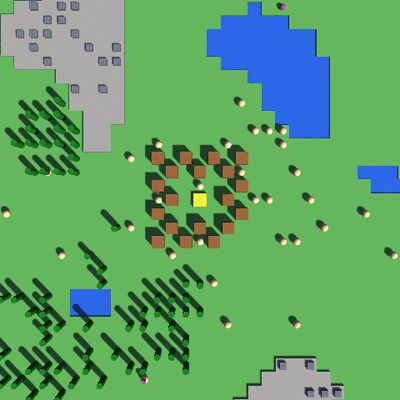

A frame of `docs/images/timelapse.gif` at `Preponderous-Software/steading@1bc2c3b`

### Kindling

A cozy first-person frontier homestead game: survey, clear, repair and furnish
a ruined cabin, one winter at a time.
[Repository](https://github.com/Preponderous-Software/kindling) ·
[play in the browser](https://kindling.play.danielstephenson.dev)

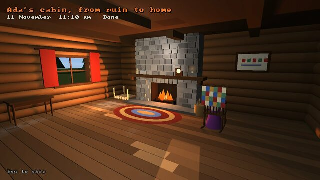

`docs/images/game-m5-home.jpg` at `Preponderous-Software/kindling@7ecf1fe`

### Atman

A first-person game about Advaita Vedānta, set around chores in a river village.
[Repository](https://github.com/Preponderous-Software/atman) ·
[play in the browser](https://atman.play.danielstephenson.dev)

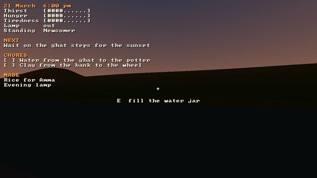

`docs/images/m1-sunset.jpg` at `Preponderous-Software/atman@02386ca`

### orrery

The whole solar system from real JPL data (DE440s, Horizons, SBDB), at true or
compressed scale, with the overlays and space lighting.
[Repository](https://github.com/Preponderous-Software/orrery) ·
[play in the browser](https://orrery.play.danielstephenson.dev)

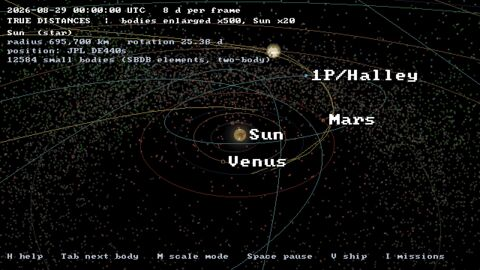

A frame of `docs/media/hero.gif` at `Preponderous-Software/orrery@8d2c090`

### Sisyphus

A first-person game about keeping software alive: push the boulder up to the
next release.
[Repository](https://github.com/Preponderous-Software/sisyphus) ·
[play in the browser](https://sisyphus.play.danielstephenson.dev)

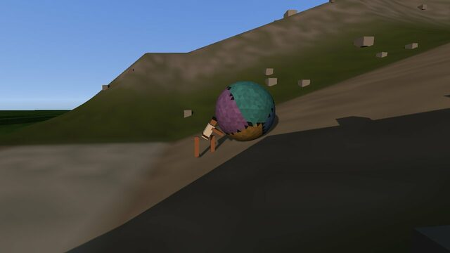

`docs/images/pushing.jpg` at `Preponderous-Software/sisyphus@88acead`

### Familiar

A Halloween night: trick-or-treat, light the lanterns for Samhain, and walk the
town as a cat.
[Repository](https://github.com/Preponderous-Software/familiar) ·
[play in the browser](https://familiar.play.danielstephenson.dev)

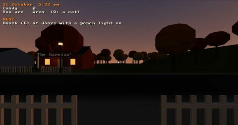

Familiar has no pictures in its repository yet. This one is a screenshot
of the live page (headless Chromium, WebGL 2 on SwiftShader), taken on
2026-10-28.

### FishE

A fishing-village game. The picture above each place's menu is rendered
offline by Strata from a scene file in the game's `art/` directory.
[Repository](https://github.com/Stephenson-Software/FishE)

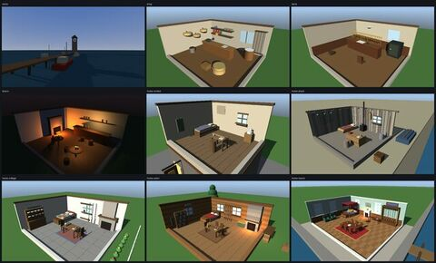

`docs/images/stills/contact-sheet.png` at `Stephenson-Software/FishE@6072be4`

### Ophidian

A snake game in Python. Its 3D window (Strata's Python binding, through
graphik's `grid3d`) and its browser build (the [grid relay](#graphik-grid3d-and-the-grid-relay))
are the same game as its 2D window; the browser starts in 3D and `?view=2d`
picks 2D.
[Repository](https://github.com/Preponderous-Software/ophidian) ·
[play in the browser](https://ophidian.play.danielstephenson.dev)

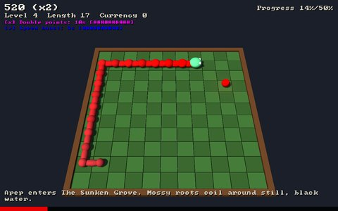

Rendered fresh by `tools/strata_snapshot.py --level 4 --ticks 150` at
`Preponderous-Software/ophidian@9c4ffa3` (the same render is proposed for its
README).

### Tic Tak Toe

Tic Tac Toe against the computer, drawn with pygame. The 3D board comes from
graphik's `grid3d`: a Strata window on the desktop, the
[grid relay](#graphik-grid3d-and-the-grid-relay) in the browser, which starts
in 3D.
[Repository](https://github.com/Stephenson-Software/Tic-Tak-Toe) ·
[play in the browser](https://tic-tak-toe.play.danielstephenson.dev)

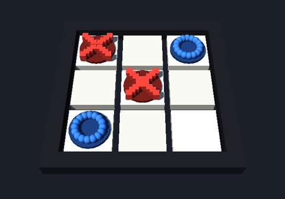

Rendered fresh by `tools/strata_snapshot.py` (the board mid-game) at
`Stephenson-Software/Tic-Tak-Toe@7ea2cc2`.

## Simulations and views

### Apex

An ecosystem simulation in Python: grass, rabbits, foxes and the rest, each a
source of energy for another. Its 3D window and browser build draw the grid
through graphik's `grid3d` and the
[grid relay](#graphik-grid3d-and-the-grid-relay); the browser starts in 3D.
[Repository](https://github.com/Preponderous-Software/apex) ·
[open in the browser](https://apex.play.danielstephenson.dev)

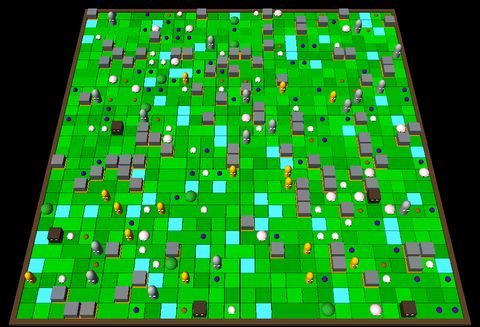

A screenshot of a local build of the browser page at
`Preponderous-Software/apex@a22dfe7` (headless Chromium, WebGL 2 on
SwiftShader), cropped to the board.

### graphik (grid3d) and the grid relay

[graphik](https://github.com/Stephenson-Software/graphik)'s `grid3d` draws a
grid game's board in 3D: tiles in a frame and pieces that slide between cells
from tick to tick. On the desktop it drives Strata's Python binding. In the
browser it sends small binary messages (board, pieces, HUD, camera) to
Strata's **grid relay** (`web/kit/grid-relay`, wire format in its `WIRE.md`),
a web-kit scene that slides the pieces between ticks itself; the relay ships
prebuilt in Strata's wasm release from 0.9.0. Ophidian, Tic Tak Toe and Apex
use both.
[graphik](https://github.com/Stephenson-Software/graphik) ·
[grid relay](../web/kit/grid-relay/)

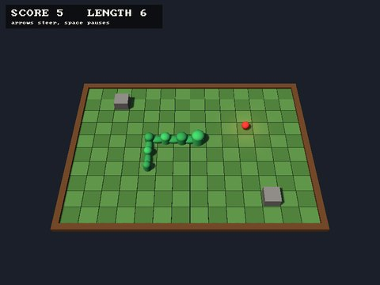

`tests/web/grid-relay/snake-settled.desktop.png` in this repository at
`363baa5`, the grid relay's golden image.

### Microbiome

A virtual microbial community. Its micro-environments run on `modules/sim` and
are drawn by Strata.
[Repository](https://github.com/Preponderous-Software/microbiome) ·
[open in the browser](https://microbiome.play.danielstephenson.dev)

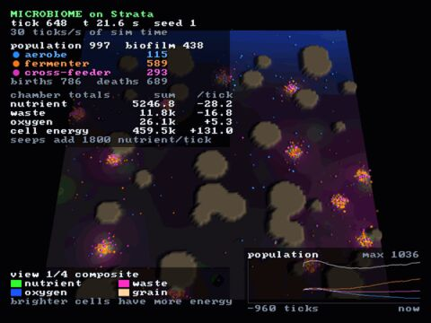

A frame of `assets/strata/micro-environment.gif` at `Preponderous-Software/microbiome@e8799be`

### env-lib-cpp

Base classes for 2D virtual worlds, with an opt-in 3D view on Strata.
[Repository](https://github.com/Preponderous-Software/env-lib-cpp) ·
[open in the browser](https://env-lib-cpp.play.danielstephenson.dev)

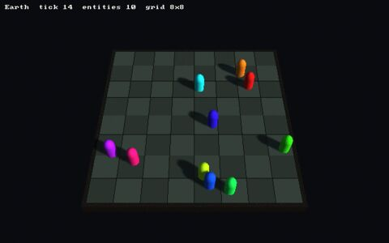

A frame of `docs/media/walkers-3d.gif` at `Preponderous-Software/env-lib-cpp@f4d73b4`

### viron-strata

A live, read-only 3D view of a Viron environment.
[Repository](https://github.com/Preponderous-Software/viron-strata) ·
[open in the browser](https://viron-strata.play.danielstephenson.dev)

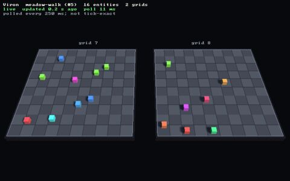

A frame of `docs/media/live-random-walk.gif` at `Preponderous-Software/viron-strata@0aecbca`

### Replay Player

One player for every `usd-replay/1` simulation replay (microbiome, steading,
Beyond Nations, Kindling), on the desktop and in the browser.
[Repository](https://github.com/Preponderous-Software/replay-player) ·
[open in the browser](https://replay-player.play.danielstephenson.dev)

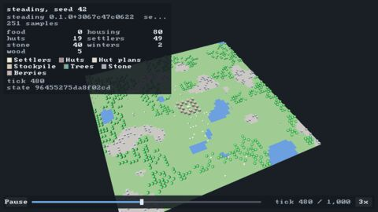

A frame of `docs/media/steading.gif` at `Preponderous-Software/replay-player@7e036bd`

### asn1-viz

3D views of ASN.1 encodings (UPER/APER bit layouts) and schemas, from asn1c.
[Repository](https://github.com/Preponderous-Software/asn1-viz) ·
[open in the browser](https://asn1-viz.play.danielstephenson.dev)

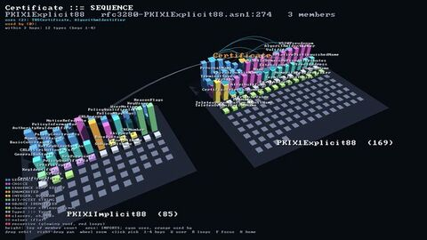

`docs/media/pkix-city.png` at `Preponderous-Software/asn1-viz@f58141f`

### gardener

A CLI that tends a fleet of repositories. Its dashboard's `/3d` page draws the
garden in WebGL 2 with Strata.
[Repository](https://github.com/Stephenson-Software/gardener)

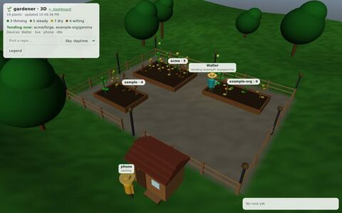

`docs/img/garden3d-gardeners.png` at `Stephenson-Software/gardener@f589de5`

### playtester

A Python toolkit for AI playtesting. Strata games can run on its headless
Strata driver, and `pt ghosts` renders where players went with the Python
binding.
[Repository](https://github.com/Preponderous-Software/playtester)

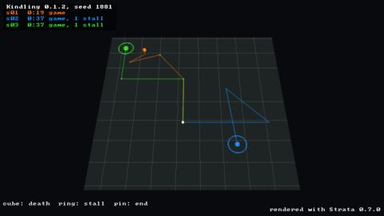

A frame of `docs/media/ghosts-kindling.gif` at `Preponderous-Software/playtester@065a16e`

## Renders and previews

### dansplugins.com

The Dan's Plugins Community site. Its world renders on plugin pages are drawn
headless with Strata from example data.
[Repository](https://github.com/Dans-Plugins/dansplugins-dot-com) ·
[site](https://dansplugins.com)

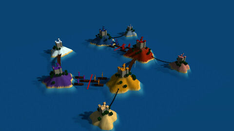

`public/renders/medieval-factions-archipelago.jpg` at `Dans-Plugins/dansplugins-dot-com@0ebc359`

### Minecraft-USD-Exporter

Exports Minecraft Java worlds to OpenUSD. Its preview script renders an export
headless with Strata.
[Repository](https://github.com/Dans-Plugins/Minecraft-USD-Exporter)

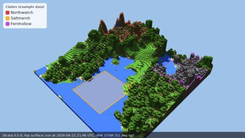

A frame of `docs/images/strata-preview-day.gif` at `Dans-Plugins/Minecraft-USD-Exporter@65436f9`

### Seasons

A planned seasonal cycle for Minecraft servers. Its README preview, one year of
the default config over a plains farm, is rendered headless with Strata.
[Repository](https://github.com/Dans-Plugins/Seasons)

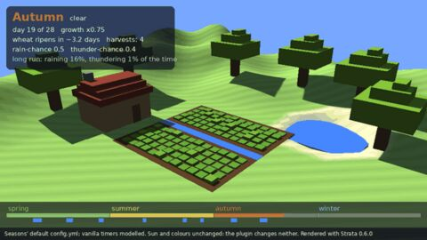

A frame of `docs/images/seasons-year.gif` at `Dans-Plugins/Seasons@85231d4`

## Adding a project

Add an entry when a public project draws with Strata:

1. Take a picture from the project's own README or docs, at a pinned commit,
   or render one fresh. Do not make one up.
2. Downscale it into `docs/media/showcase/` as a still (at most 480 px wide,
   ideally under 50 KB). Use a still frame of an animation; the whole folder
   stays under 2 MB.
3. Add the entry here with the source path and commit, and, if it fits, a
   thumbnail in the README's "Made with Strata" grid.
4. Add the repository to `PROJECTS` in `tools/make_family_media.py` (its size
   from `tools/make_family_media.py --refresh`) and run it to redraw the family
   picture above.

Private projects are not listed.
