# Made with Strata

Every public project that draws with Strata, with a picture from the project
itself. Each image is copied from that project's own README or docs at the
commit named under it and downscaled to fit here, or, where a project has no
pictures yet, taken from its live page. None is a mock-up.

Projects that run in a browser are also in the arcade at
<https://danielstephenson.dev/play>.

- [Games](#games)
- [Simulations and views](#simulations-and-views)
- [Renders and previews](#renders-and-previews)
- [Adding a project](#adding-a-project)

## Games

### Beyond Nations

A sandbox nation-simulation RPG: settlements, resources and rival nations grow
around you. The simulation is C# and reaches Strata through the C ABI.
[Repository](https://github.com/Preponderous-Software/beyond-nations) ·
[play in the browser](https://beyond-nations.play.danielstephenson.dev)

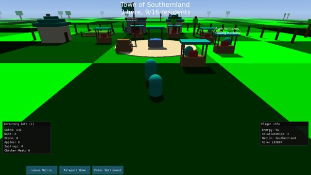

`.github/media/settlement-town.png` at `Preponderous-Software/beyond-nations@e012fb0`

### steading

A USD-native colony sim in C++: OpenUSD is the world, save and mod format over
a flat ECS runtime. It uses the renderer and `modules/save`.
[Repository](https://github.com/Preponderous-Software/steading) ·
[play in the browser](https://steading.play.danielstephenson.dev)

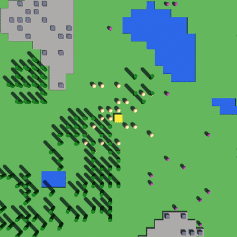

`docs/images/timelapse.gif` at `Preponderous-Software/steading@1bc2c3b`

### Kindling

A cozy first-person frontier homestead game: survey, clear, repair and furnish
a ruined cabin, one winter at a time.
[Repository](https://github.com/Preponderous-Software/kindling) ·
[play in the browser](https://kindling.play.danielstephenson.dev)

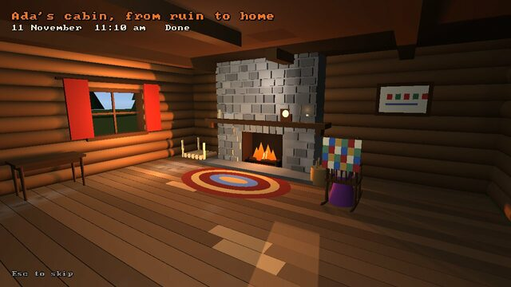

`docs/images/game-m5-home.jpg` at `Preponderous-Software/kindling@7ecf1fe`

### Atman

A first-person game about Advaita Vedānta, set around chores in a river village.
[Repository](https://github.com/Preponderous-Software/atman) ·
[play in the browser](https://atman.play.danielstephenson.dev)

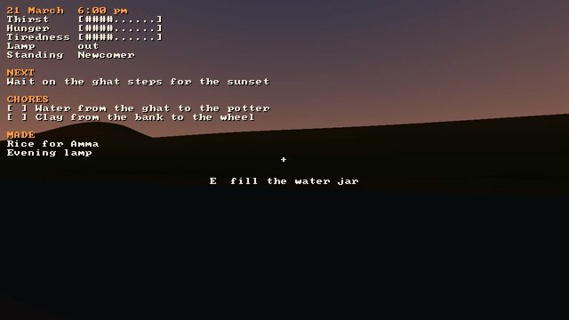

`docs/images/m1-sunset.jpg` at `Preponderous-Software/atman@02386ca`

### orrery

The whole solar system from real JPL data (DE440s, Horizons, SBDB), at true or
compressed scale, with the overlays and space lighting.
[Repository](https://github.com/Preponderous-Software/orrery) ·
[play in the browser](https://orrery.play.danielstephenson.dev)

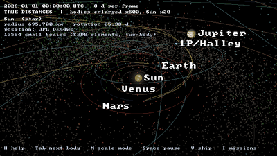

`docs/media/hero.gif` at `Preponderous-Software/orrery@8d2c090`

### Sisyphus

A first-person game about keeping software alive: push the boulder up to the
next release.
[Repository](https://github.com/Preponderous-Software/sisyphus) ·
[play in the browser](https://sisyphus.play.danielstephenson.dev)

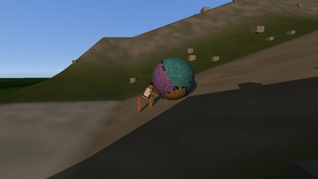

`docs/images/pushing.jpg` at `Preponderous-Software/sisyphus@88acead`

### Familiar

A Halloween night: trick-or-treat, light the lanterns for Samhain, and walk the
town as a cat.
[Repository](https://github.com/Preponderous-Software/familiar) ·
[play in the browser](https://familiar.play.danielstephenson.dev)

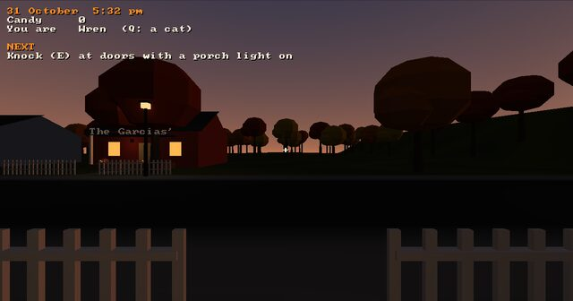

Familiar has no pictures in its repository yet. This one is a screenshot
of the live page (headless Chromium, WebGL 2 on SwiftShader), taken on
2026-10-28.

### FishE

A fishing-village game. The picture above each place's menu is rendered
offline by Strata from a scene file in the game's `art/` directory.
[Repository](https://github.com/Stephenson-Software/FishE)

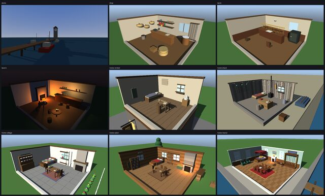

`docs/images/stills/contact-sheet.png` at `Stephenson-Software/FishE@6072be4`

## Simulations and views

### Microbiome

A virtual microbial community. Its micro-environments run on `modules/sim` and
are drawn by Strata.
[Repository](https://github.com/Preponderous-Software/microbiome) ·
[open in the browser](https://microbiome.play.danielstephenson.dev)

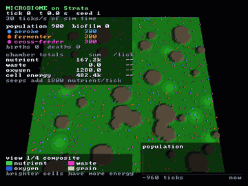

`assets/strata/micro-environment.gif` at `Preponderous-Software/microbiome@e8799be`

### env-lib-cpp

Base classes for 2D virtual worlds, with an opt-in 3D view on Strata.
[Repository](https://github.com/Preponderous-Software/env-lib-cpp) ·
[open in the browser](https://env-lib-cpp.play.danielstephenson.dev)

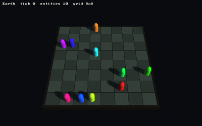

`docs/media/walkers-3d.gif` at `Preponderous-Software/env-lib-cpp@f4d73b4`

### viron-strata

A live, read-only 3D view of a Viron environment.
[Repository](https://github.com/Preponderous-Software/viron-strata) ·
[open in the browser](https://viron-strata.play.danielstephenson.dev)

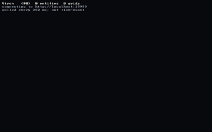

`docs/media/live-random-walk.gif` at `Preponderous-Software/viron-strata@0aecbca`

### Replay Player

One player for every `usd-replay/1` simulation replay (microbiome, steading,
Beyond Nations, Kindling), on the desktop and in the browser.
[Repository](https://github.com/Preponderous-Software/replay-player) ·
[open in the browser](https://replay-player.play.danielstephenson.dev)

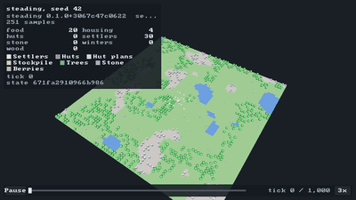

`docs/media/steading.gif` at `Preponderous-Software/replay-player@7e036bd`

### asn1-viz

3D views of ASN.1 encodings (UPER/APER bit layouts) and schemas, from asn1c.
[Repository](https://github.com/Preponderous-Software/asn1-viz) ·
[open in the browser](https://asn1-viz.play.danielstephenson.dev)

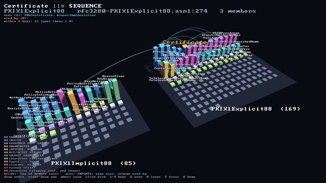

`docs/media/pkix-city.png` at `Preponderous-Software/asn1-viz@f58141f`

### gardener

A CLI that tends a fleet of repositories. Its dashboard's `/3d` page draws the
garden in WebGL 2 with Strata.
[Repository](https://github.com/Stephenson-Software/gardener)

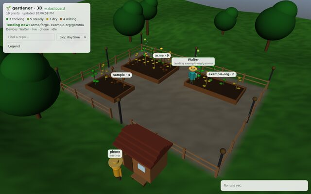

`docs/img/garden3d-gardeners.png` at `Stephenson-Software/gardener@f589de5`

### playtester

A Python toolkit for AI playtesting. Strata games can run on its headless
Strata driver, and `pt ghosts` renders where players went with the Python
binding.
[Repository](https://github.com/Preponderous-Software/playtester)

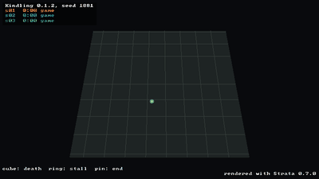

`docs/media/ghosts-kindling.gif` at `Preponderous-Software/playtester@065a16e`

## Renders and previews

### dansplugins.com

The Dan's Plugins Community site. Its world renders on plugin pages are drawn
headless with Strata from example data.
[Repository](https://github.com/Dans-Plugins/dansplugins-dot-com) ·
[site](https://dansplugins.com)

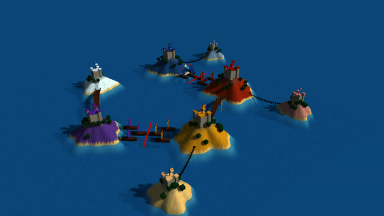

`public/renders/medieval-factions-archipelago.jpg` at `Dans-Plugins/dansplugins-dot-com@0ebc359`

### Minecraft-USD-Exporter

Exports Minecraft Java worlds to OpenUSD. Its preview script renders an export
headless with Strata.
[Repository](https://github.com/Dans-Plugins/Minecraft-USD-Exporter)

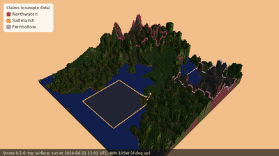

`docs/images/strata-preview-day.gif` at `Dans-Plugins/Minecraft-USD-Exporter@65436f9`

### Seasons

A planned seasonal cycle for Minecraft servers. Its README preview, one year of
the default config over a plains farm, is rendered headless with Strata.
[Repository](https://github.com/Dans-Plugins/Seasons)

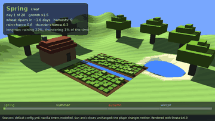

`docs/images/seasons-year.gif` at `Dans-Plugins/Seasons@85231d4`

## Adding a project

Add an entry when a public project draws with Strata:

1. Take a picture from the project's own README or docs, at a pinned commit,
   or render one fresh. Do not make one up.
2. Downscale it into `docs/media/showcase/` (at most 640 px wide; a GIF at
   most 2 MB, ideally about 1 MB).
3. Add the entry here with the source path and commit, and, if it fits, a
   thumbnail in the README's "Made with Strata" grid.

Private projects are not listed.
