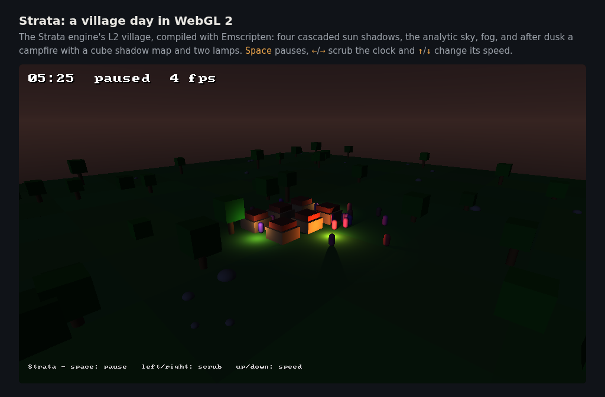

# Strata in the browser (WebGL 2)

Strata builds with [Emscripten](https://emscripten.org) and draws through
WebGL 2. The C ABI (`include/strata/strata.h`) is the same in the browser as on
the desktop, so a host that already calls it recompiles without code changes.
Only who runs the frame loop differs (see [The frame loop](#the-frame-loop)).

## What runs where

| | Desktop (default) | Browser |
|---|---|---|
| GL | OpenGL 4.5 core, direct state access (`src/rhi/gl45_device.cpp`) | WebGL 2 = OpenGL ES 3.0 (`src/rhi/gles3_device.cpp`) |
| Shaders | GLSL 4.50 in `src/render/shaders.hpp` | The same shaders, rewritten to GLSL ES 3.00 when each pipeline is created (`src/rhi/glsl_es.cpp`) |
| Window and input | SDL3 (X11, Wayland, Win32) | SDL3's Emscripten driver: a canvas, DOM keyboard and mouse events |
| Headless | EGL surfaceless | a hidden SDL3 window on the canvas |
| Loader | glad | none (Emscripten's WebGL bindings) |
| Output | `libstrata.so` / `strata.dll` | static archives: `libstrata.a` |

The GLES 3 device is also built into the desktop library. Setting
`STRATA_GL_API=gles3` makes the desktop library use it on any OpenGL ES 3.0
context (Mesa's GLES through EGL in CI), which is how its pixels are tested
without a browser.

### Features and differences

Every render path works on WebGL 2: the legacy primitives, the sun with four
cascaded shadow maps, the moon, hemisphere ambient, fog and the analytic sky,
up to 32 point lights, up to 4 point-light cube shadow maps, the terrain tile,
static and textured meshes (with mip maps), and the overlays (lines, points,
text). There is no lower-quality mode.

What GLES 3.0 lacks is emulated inside the device, so the passes are the same
code on both:

| Desktop GL 4.5 feature | On WebGL 2 | Visible difference |
|---|---|---|
| Cube map arrays (`samplerCubeArrayShadow`, point-light shadows) | One cube map per shadowed light, on texture units 2 and 5–7, chosen in the shader by a branch | None: the GLES device on llvmpipe draws the 22 desktop goldens with 0 pixels over ΔE 4 |
| `GL_DEPTH_CLAMP` (sun shadow casters, overlays past the far plane) | `EXT_depth_clamp` where the browser has it (Chromium does, SwiftShader included). Otherwise the vertex shader stops near/far clipping and the fragment shader writes the clamped depth plus the shadow pass's polygon offset to `gl_FragDepth` | None measured: both paths draw the same pixels in Chromium and on llvmpipe. Without the extension the shadow pass loses early depth testing (slower) |
| Base vertex and base instance in draws | Folded into the vertex attribute offsets at draw time | None |
| `layout(binding = N)` in GLSL | Set through the API after linking | None |
| Debug output and object labels | Not available | `STRATA_FLAG_DEBUG_CONTEXT` logs nothing extra |

Browsers differ from the desktop only in rasterisation detail at polygon
edges: in headless Chromium (SwiftShader) the 22 golden scenes differ from the
desktop llvmpipe goldens by 0.004 % to 0.11 % of pixels, all inside the
desktop tolerance (0.5 %). CI checks them against their own goldens
(`tests/golden/*/web-swiftshader.png`, 0 pixels over ΔE 4) and against the
desktop goldens at the desktop tolerance.

Limits that matter in a browser:

- Strata needs 9 fragment texture units: it binds units 1 to 7 and uses the
  device's last unit as a scratch unit while creating textures. WebGL 2's
  minimum is 16, but some phone browsers report fewer (13 has been seen), so
  the scratch unit is not fixed at 15.
- Shadow maps are as on the desktop (cascades default to 2048², cube faces
  512²). On a weak GPU, lower `StrataLighting.shadow_map_size` and
  `cascade_count`.
- Strata is single-threaded and needs no `SharedArrayBuffer`, so pages need no
  COOP/COEP headers on its account.

## Building

You need CMake 3.24 or newer and emsdk. CI uses **emsdk 6.0.11** (pinned in
`.github/workflows/ci.yml`).

```sh
git clone https://github.com/emscripten-core/emsdk.git && cd emsdk
./emsdk install 6.0.11 && ./emsdk activate 6.0.11 && source ./emsdk_env.sh
cd /path/to/strata
emcmake cmake -S . -B build-web -DCMAKE_BUILD_TYPE=Release
cmake --build build-web -j8
ctest --test-dir build-web --output-on-failure     # unit tests, under Node
```

The build produces, in `build-web/`:

- `libstrata.a`: the engine, its image code and SDL3 merged into one archive.
  It defines the whole C ABI. (`libstrata_static.a`, `libstrata_image.a` and
  SDL3's archive are also there for CMake consumers that link
  `strata::static`.)
- `strata-village-day.html` (+ `.js`, `.wasm`, `.data`): the demo below.
- `strata-golden.html`: the golden-image checker as a web page, for
  `tests/web/run_goldens.cjs`.

Options:

| CMake option | Default | Meaning |
|---|---|---|
| `STRATA_WASM_EXCEPTIONS` | `wasm` | How C++ exceptions are compiled: `wasm` (`-fwasm-exceptions`) or `js` (`-fexceptions`). Strata turns internal exceptions into status codes at the C ABI, so they must be catchable. **Everything linked into one `.wasm` must use the same mode.** |
| `STRATA_BUILD_EXAMPLES` | `ON` | the demo |
| `STRATA_WITH_SIM` | `ON` | `modules/sim` (`libstrata_sim.a`) |

## The demo



```sh
cd build-web && python3 -m http.server 8000
# open http://localhost:8000/strata-village-day.html
```

`examples/village-day/main.cpp` uses only the C ABI. The same file builds
natively (`./build/strata-village-day`, an SDL3 window) and for the browser.

## Linking Strata into your own page

Link `libstrata.a` and include `strata.h`. The link needs WebGL 2 and the same
exception mode:

```sh
emcc game.c build-web/libstrata.a -Iinclude \
  -sMIN_WEBGL_VERSION=2 -sMAX_WEBGL_VERSION=2 -sALLOW_MEMORY_GROWTH=1 -fwasm-exceptions \
  -o game.html
```

From CMake, `target_link_libraries(game PRIVATE strata::static)` brings the
WebGL 2 link options with it.

### Surfaces in a browser

| Surface | In a browser |
|---|---|
| `STRATA_SURFACE_WINDOW` | SDL3 creates a WebGL 2 context on the canvas `#canvas` (change it with SDL's `SDL_HINT_EMSCRIPTEN_CANVAS_SELECTOR`) and sizes it to `width` x `height` CSS pixels times the device pixel ratio. Keyboard, mouse, wheel and text events arrive through `strata_poll_event` as on the desktop. |
| `STRATA_SURFACE_HEADLESS` | No EGL in a browser: a hidden SDL3 window, so it still needs a canvas. |
| `STRATA_SURFACE_HOST_CONTEXT` | Strata draws into the WebGL 2 context the host made current (`emscripten_webgl_make_context_current`). `get_proc_address` must still be non-NULL, as the ABI requires, but it is never called: Emscripten's bindings are used. `strata_create` fails with `STRATA_ERROR_PLATFORM` if no WebGL context is current. Strata saves and restores the GL state it touches, as on the desktop. |

### The frame loop

A browser page must return to the browser between frames, so a host cannot
loop forever around `strata_begin_frame` ... `strata_present`. Run one frame
per callback instead: `emscripten_set_main_loop_arg` (as the demo does), or
`requestAnimationFrame` in JavaScript calling an exported function. Present is
a no-op in a browser: the canvas is shown when the callback returns.

## Beyond Nations (.NET `browser-wasm`)

Notes for linking Strata into a .NET WebAssembly app (`wasm-tools` workload,
`RuntimeIdentifier=browser-wasm`). These are what is known now. The .NET
side has not been built against Strata yet, so check each point on the first
attempt.

1. **Emscripten version.** The .NET wasm workload links with its own emsdk
   (the `Microsoft.NET.Runtime.Emscripten.*` packages; see the
   `EmscriptenVersion` it reports). Object files from a much newer Emscripten
   (Strata's CI uses 6.0.11) may not link with an older `wasm-ld`. Build
   Strata with the same emsdk version as the .NET workload:
   `emcmake cmake -S . -B build-web ...` with that emsdk activated. If SDL
   3.4.16 does not build with that older Emscripten, configure with
   `-DSTRATA_WITH_SDL=OFF` and use `STRATA_SURFACE_HOST_CONTEXT` (below).
2. **Exceptions.** .NET's native link uses one exception mode for the whole
   module (`WasmEnableExceptionHandling`, true by default in recent .NET:
   `-fwasm-exceptions`). Build Strata with the matching
   `-DSTRATA_WASM_EXCEPTIONS=wasm` (or `js` if exception handling is off).
3. **Native reference.** Add the archive and the WebGL link flags:

   ```xml
   <PropertyGroup>
     <WasmBuildNative>true</WasmBuildNative>
     <EmccExtraLDFlags>$(EmccExtraLDFlags) -sMIN_WEBGL_VERSION=2 -sMAX_WEBGL_VERSION=2</EmccExtraLDFlags>
   </PropertyGroup>
   <ItemGroup>
     <NativeFileReference Include="path/to/libstrata.a" />
   </ItemGroup>
   ```

   The .NET build generates its P/Invoke table from the `DllImport` library
   names and the native files. If Strata's `[DllImport("strata")]` does not
   resolve against `libstrata.a`, rename the archive to `strata.a` (the
   module name and file name then match) before referencing it.
4. **Surface.** .NET's browser runtime does not create a GL context. Either
   let Strata create one with `STRATA_SURFACE_WINDOW` (SDL3 then needs a
   `<canvas id="canvas">` on the page, or the hint above), or create a WebGL 2
   context on the page yourself, make it current, and use
   `STRATA_SURFACE_HOST_CONTEXT` with any non-NULL `get_proc_address`.
5. **Frame loop.** Drive frames from the browser (`requestAnimationFrame`
   through JS interop, or a `setInterval`-style timer), one
   `begin_frame`/`end_frame` per callback; a blocking `while` loop on the main
   thread freezes the page.
6. **Threads.** Strata is single-threaded and does not need .NET's threaded
   wasm build.

## Testing

| What | How | Golden set |
|---|---|---|
| The GLES 3 device, natively | `STRATA_GL_API=gles3 strata-golden check tests/scenes tests/golden out` (EGL, Mesa llvmpipe) | the desktop goldens, `linux-llvmpipe.png` |
| The same without `EXT_depth_clamp` | add `STRATA_GLES_NO_DEPTH_CLAMP=1` | the desktop goldens |
| The browser | `node tests/web/run_goldens.cjs build-web out --platform web-swiftshader` (headless Chromium, SwiftShader) | `web-swiftshader.png` |
| The browser without `EXT_depth_clamp` | `STRATA_WEB_ENV=STRATA_GLES_NO_DEPTH_CLAMP=1 node tests/web/run_goldens.cjs ...` | `web-swiftshader.png` |
| The browser against the desktop | `node tests/web/run_goldens.cjs build-web out --platform linux-llvmpipe` | the desktop goldens, default tolerance |

`run_goldens.cjs` needs Playwright (`npm install --prefix tests/web
playwright@1.61.1 && npx --prefix tests/web playwright install chromium`); the
Playwright version pins Chromium and therefore SwiftShader. To bless new web
goldens, add `--bless`: they are written to `<out>/golden/`. Bless from CI's
pinned Chromium, as for the desktop goldens (see
[GOLDEN_IMAGES.md](GOLDEN_IMAGES.md)).

The README's browser images come from `tools/make_web_media.py build-web`.
